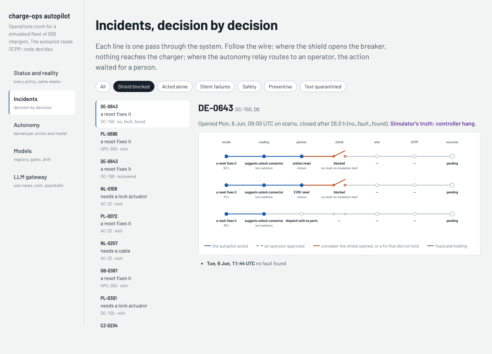

# charge-ops-autopilot

Most AI lives in a chat window. This one runs a charging network: an operations autopilot for a
simulated pan-European fleet of 900 fast and AC chargers in 11 countries, speaking OCPP 2.0.1.

It finds failures the status page does not show (a controller that stalls while reporting
Available, a card reader that stops reading), fixes what a remote action can fix, takes chargers
out of service when they would only fail drivers, sends technicians with the right part on routes
an optimiser plans, rolls back a bad firmware release in stages, and earns the right to act without
a person one action and hardware model at a time. Models read; code decides; a shield with sourced
rules has the last word on every action.



RESULTS

## How it works

```
 OCPP 2.0.1 ──► CSMS (WebSockets, append-only PostgreSQL record)
                  │ messages, complaints, visit reports, diagnostic logs
                  ▼
           hourly signals ──► features (the same code in training and serving)
                  │
      symptoms ──►│ incidents (silent failures included)
                  ▼
   diagnosis model (LightGBM, ONNX) ──┐
   LLM reading of vendor text, logs, ├──► planner: expected success of each remote action
   complaints + manuals (BM25)        │    (Beta beliefs, updated by outcomes), or a visit
     └─ through the LLM gateway       ┘                │
                                                       ▼
                                   shield (rules with sources) ──► autonomy ladder
                                                       │            act alone │ operator approves
                                                       ▼
                                      Reset / UnlockConnector / ChangeAvailability / GetLog / UpdateFirmware
 daily: failure-risk model ──► preventive visits;  technicians' routes (OR-Tools, prize-collecting VRP)
 daily: firmware cohorts (exact binomial test) ──► halt rollout, staged rollback (a person approves)
 weekly: retrain ──► offline gate ──► ONNX parity ──► shadow ──► promotion (MLflow registry)
```

| Part | What it is | Where |
|---|---|---|
| Fleet simulator | 900 chargers, 4 hardware models, 9 fault kinds, outages, firmware rollouts, drivers, complaints in 10 languages, technicians; OCPP 2.0.1 rows validated against the official schemas | `src/cpa/sim` |
| Central system | OCPP 2.0.1 over WebSockets (`ocpp` library, schema-validated both ways), append-only PostgreSQL record, commands with the shield's verdict | `src/cpa/csms`, `sql/csms.sql` |
| Features and labels | hourly signals by *received* time, point-in-time windows, incidents and labels from what was observed to fix them | `src/cpa/ml` |
| Models | diagnosis (multiclass) and 48 h failure risk (binary), LightGBM, exported to ONNX | `src/cpa/ml/models.py` |
| MLOps | MLflow registry with aliases, model cards, offline gate, ONNX parity and latency, shadow scoring, weekly retraining, drift (PSI) | `src/cpa/mlops` |
| LLM gateway | use cases with owners, routes and fallback, token limits, daily budgets, cache, PII masking, quarantine of instruction-like text, output schemas, OpenTelemetry GenAI spans; exported as Azure APIM policies | `src/cpa/gateway`, `azure/apim` |
| Autopilot | incidents, planner, shield, autonomy ladder, preventive visits, firmware cohorts, dispatch | `src/cpa/ops` |
| Service API | FastAPI: model scoring and the gateway for other teams, bearer auth, Prometheus metrics | `src/cpa/service` |
| Azure | Bicep (Container Apps, PostgreSQL, Azure ML, API Management, Key Vault, budgets), Azure ML pipeline and online endpoint | `azure/` |
| Operations room | React 19, Vite, TypeScript, motion; decisions drawn as single-line diagrams | `web/` |

## Run it

```bash
uv sync
uv run pytest -q -m "not slow"     # seconds; `uv run pytest -q` adds the slow and PostgreSQL tests
uv run cpa run                     # fleet, history, champions, six policies, evaluation, release gate
uv run cpa export-web && cd web && npm ci && npm run build && npx playwright test
uv run cpa serve-csms              # an OCPP 2.0.1 central system on :9000
uv run cpa serve-api               # model scoring and the gateway on :8000
uv run cpa heldout fleets-2026-10  # the blind held-out fleets (first run recorded once)
```

## Limits

- The fleet is simulated. The numbers show that the methods work on a fleet built to behave like a
  real one; they say nothing about EDRI's fleet. Fault rates, remedy probabilities and costs are
  assumptions in `config/fleet.yaml`.
- No model key is available here, so the LLM calls go to a deterministic stand-in that reads the
  same prompt fields with rules (and follows injected instructions the way a naive model would, to
  test the guardrails). With `ANTHROPIC_API_KEY` or a Microsoft Foundry endpoint the same prompts go
  to Claude. Costs and latencies of LLM calls are what the estimated tokens would cost at list
  prices and a modelled latency, not measurements.
- The Azure templates compile in CI; they have not been deployed from this repository.
- The simulator, the operations code and the held-out guide were written by the same author; the
  held-out fleets were written blind by an agent that read only the guide and the simulator.
